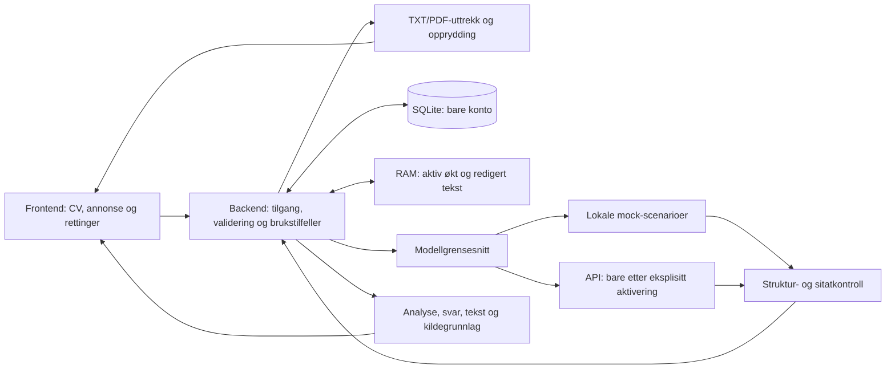

# Utkast fra Miranda – til gruppevurdering

KI-utarbeidet for Miranda Eriksen Larsen. **Ingen tekniske forslag nedenfor er gruppevedtak.** Gjeldende [PRD](../../prds/prd-supersoker-2026-11-03/prd.md) er kravkilden; begrunnelser, alternativer og åpne valg står i [avklaringsnotatet](avklaringer-og-testkobling.md) og [.memlog.md](.memlog.md).

## Foreslått struktur og dataflyt

Lagdeling: frontend → backendens brukstilfeller → konto-/dokument-/modelladaptere. Adapterne velger ikke brukerflyt eller oppdaterer økten direkte. Anbefalt oppsett A er FastAPI med HTML/Jinja2, CSS og små JavaScript-moduler; lokal SQLite for kontoer og pypdf som parserkandidat. Ingen versjoner er låst.

Først leses/valideres CV; brukeren retter teksten. Tittel og arbeidsgiver vises for retting/avklaring før gap-analysen. Deretter valideres analysen, brukeren svarer på eventuelle gap og velger resultattypen. «Lag tekst» bruker godkjent analyse og aktuelle svar. Navigasjon/reload starter ingen modellkall.

## Foreslåtte konsistensregler

### AD-1 — Én lokal app og én eier av tilstand [FORSLAG]

- **Binds:** frontend, backend, FR-1–3/20–24, NFR-7.
- **Prevents:** ulike tilgangsregler og konkurrerende kopier av øktdata.
- **Rule:** Backend serverer frontend og relative API-ruter på samme origin, bundet til loopback. Én appprosess eier alle økter; ingen produksjons-/fellesserver inngår. Frontend viser tilstand, backend validerer og autoriserer alle lesinger/endringer. Visningskode har aldri database- eller modellnøkkeltilgang.

### AD-2 — Konto på disk, arbeidsdata i aktiv økt [FORSLAG]

- **Binds:** FR-1–3/20–25, NFR-4/5, T-4/6/10.
- **Prevents:** dokumenthistorikk i kontolageret og gjenoppretting etter sletting.
- **Rule:** SQLite lagrer kontoens e-post og sikker passordhash, med nødvendige interne kontonøkler; ingen CV, svar, analyser eller resultater. Foreslått hash er Argon2 via vedlikeholdt bibliotek. Innlogging lager en tilfeldig, ugjennomsiktig økt-ID i HttpOnly/SameSite-cookie; backend kobler den til konto og RAM-data. Tilstandsendrende forespørsler har CSRF-vern. Ikke bruk et signert cookieinnhold som dokumentlager. Kontroller eierskap fra autentisert økt, aldri fra klientoppgitt bruker-ID.

Foreslått aktivitet er aktiv redigering og brukerutløste handlinger; polling, reload og statusoppdatering teller ikke. Ved 30 minutters inaktivitet ugyldiggjøres økten og RAM-data slettes av en serverstyrt rydder, også uten åpen fane; tilgang sjekker alltid fristen. Fristen og faktisk sletterytme må testes med simulert tid. Logout gjør det samme straks. Et sent svar får bare lagres hvis økt-ID og handlingsversjon fortsatt er gyldige. Dette er nødvendig for FR-23 selv om generell ignorering av sene svar er *bør*.

Frontend synkroniserer redigeringer til økten; reload henter lagret tekst uten nytt kall. Kvittering, rekkefølge og feil ved siste uferdige lagring må avklares og testes før løsningen kan hevdes å oppfylle reload-kravet. Serverrestart mister RAM-økter og krever ny innlogging; dette er en foreslått driftsbegrensning til gruppevurdering. Dokumenter cachelagres ikke på disk; svar bruker no-store og UI tømmer lokale visninger ved logout/utløp.

**NFR-5 gjelder alle tekniske logger:** CV-tekst og brukerens svar skal aldri logges, heller ikke i feilmeldinger, unntaksdetaljer eller logging av modellkall. Unngå rå forespørsler, modellpayloads og modellsvar som kan gjengi dette innholdet; bruk innholdsfrie feilkoder og tekniske metadata. Regelen omfatter også rammeverkets og SDK-ets logging. Prosjektets sesjonslogger dokumenterer oppdrag, vurderinger og testresultater, ikke appens kjørehendelser; heller ikke der kopieres CV-tekst eller brukersvar fra appen.

### AD-3 — Innlesing er en avgrenset serveroperasjon [FORSLAG]

- **Binds:** FR-4–9/29, T-1/5/9.
- **Prevents:** tillit til filendelse, hengende tempfiler og tap av forrige gyldige CV.
- **Rule:** Kontroller bytegrense under mottak, filinnhold, parsebarhet og tekstlengde på server. Avvis andre formater, krypterte/korrupte PDF-er og tomt uttrekk med PRD-ens forståelige tiltak. TXT-dekoding og normalisering skal være eksplisitt og testes med norske tegn. Vis uttrekket til retting. Ingen OCR. Lukk/slett opplastings- og midlertidige filer i en garantert oppryddingssti ved både suksess og feil; bytt først gyldig CV når uttrekket er godkjent. Parserens ressurs-/tidsgrense må avklares; filstørrelse alene begrenser ikke dekomprimert PDF-minnebruk.

### AD-4 — Felles modellkontrakt, kontroll før publisering [FORSLAG]

- **Binds:** FR-9–19/21/25–30, NFR-8, T-2/3/4/6/8/9.
- **Prevents:** ulik mock/API-atferd og delvis godkjenning av ugyldig analyse.
- **Rule:** Én modul tilbyr `avklar_stilling`, `analyser` og `lag_tekst` med samme inn-/utdataskjema for begge adaptere. Avklaring returnerer funnet/mangler/tvetydig per stillingsfelt; brukerrettinger overstyrer funn. Et eventuelt API-kall for avklaring er synlig, bekreftet og budsjettert som alle andre kall, ikke et skjult gratis steg.

Analyseobjektet har separat liste over kompetansekrav (stabil krav-ID, status, sitat ved «Dokumentert») og ansettelsesvilkår. Svar kobles til krav-ID og aktuell analyseversjon. Struktur og alle dokumenterende sitater valideres før hele analysen lagres; ett ugyldig sitat avviser alt. Reelle analyser kontrolleres mot den nøyaktige, rettede CV-versjonen som faktisk ble analysert, ikke mot senere redigeringer. Faste mock-scenarioer kontrolleres mot tilhørende fiktive CV-testdata, bundet til scenario-ID og testdataversjon. Samme ordrett-kontroll brukes i begge moduser; den slås ikke av for mock. Manglende eller feil koblet kildegrunnlag avviser resultatet.

Ved egen tekst i mock-modus velges et fast eksempelscenario med sitt eget fiktive CV-grunnlag. Både eksemplet, sitatene og kildevisningen merkes som eksempel fra dette scenarioet; meldingen sier uttrykkelig at brukerens tekst ikke er analysert. Eksempelgrunnlaget holdes atskilt fra brukerens CV, og eksempelresultatet skal aldri presenteres som dokumentasjon av brukerens kvalifikasjoner. Ingen automatisk semantisk garanti hevdes. Generering bruker godkjent analyse og samme kildegrunnlag, annonse, avklarte stillingsfelt, svar og resultatvalg; mock følger sine faste eksempelvarianter. Resultatet skiller redigerbar tekst, kildegrunnlag og veiledning; bare teksten kopieres. Negasjoner/usikkerhet må bevares og kontrolleres mot ekte modell.

Mock returnerer faste scenarioer og merket eksempel ved egen tekst; ingen nettressurser lastes. API krever eksplisitt modus, servernøkkel og leverandørbekreftelse én gang per økt før første kall. Ugyldig API-konfigurasjon gir feil uten mock-fallback. Ugyldig svar vises aldri delvis. Ingen automatiske retries, heller ikke i valgt SDK. Manuell retry gjør høyst ett nytt kall. Frontend sperrer pågående handling; serverduplikatvern er fortsatt *bør*. Bekreftet CV-/annonseendring forkaster analyse/svar/tekst etter FR-21; avbryt bevarer alt.

### AD-5 — Betalt modus sperres når kostnad ikke kan begrenses [FORSLAG]

- **Binds:** FR-29/30, NFR-6, T-5/6.
- **Prevents:** at omstart eller flere maskiner nullstiller budsjettet ubemerket.
- **Rule:** Ingen varig forbruksteller i appen innføres av dette utkastet. Før betalt aktivering må gruppa godkjenne en mekanisme som håndhever samlet grense på 100 kr på tvers av omstarter og maskiner. Uavklart/ukjent restbudsjett betyr ingen betalte kall. Mock forblir kjørbar.

Innen en godkjent kjøring reserveres konservativ maksimal kostnad før hvert avklarings-, analyse- eller genereringskall, med serialisert budsjettoppdatering. Samlet input inkludert prompt/svar og maksimal output må begrenses; timeout/ukjent fakturering beholder reservasjonen. In-memory-reservasjon er ikke en løsning for omstart alene. Se [lagringsavklaringen](avklaringer-og-testkobling.md#forbruksteller-og-permanent-lagring).

## Utsatt og avhengig av gruppevalg

Endelig stack, bibliotekversjoner, grenser/målinger og budsjettmekanisme er åpne. **UX-avhengig:** komponenter, kildepanel/sitatposisjoner, dialogutforming, fokus og testbredder. Ingen visuell retning velges. Full drift, mikrotjenester, dokumenthistorikk, OCR, eksport og andre utsatte produktfunksjoner innføres ikke.
