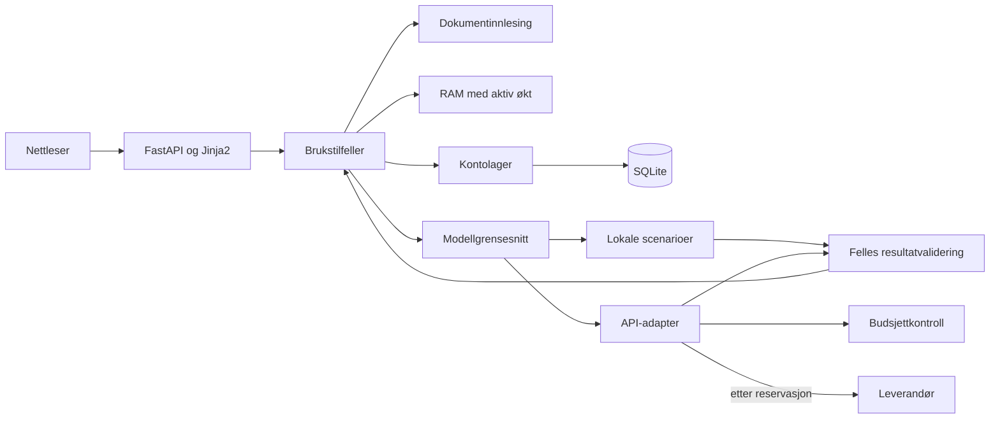

# Arkitektur for Supersøker V1

Status `final` gjelder arkitekturbeslutningene. Implementasjon og verifikasjon følges opp i [teststrategien](teststrategi.md).

Supersøker kjører lokalt som én FastAPI-app. Nettleseren viser tre steg fra CV og annonse til gap-analyse og redigerbar søknadstekst. Kontoen overlever omstart i SQLite. Alt arbeid ligger i serverens RAM og forsvinner ved utlogging, 30 minutters inaktivitet eller omstart. Sensor kan prøve hele flyten med fiktive data i mock-modus. Betalt testing krever en sentral tildeling innenfor gruppas samlede grense på 100 kr.

Gruppa har vedtatt stakken, SQLite bare for kontoer, RAM og sletting ved utlogging, inaktivitet og omstart, mock som standard, sentral kostnadskontroll på 100 kr med sperre per kall, prioritering av duplikatvern og sene svar, utsatt 25-minuttersvarsel og desktopgrunnlaget. De nummererte arkitekturreglene konkretiserer vedtakene med tekniske forslag. [Teststrategien](teststrategi.md) beskriver hvordan forslagene skal verifiseres. PRD-en styrer alle obligatoriske krav. [Issue #21](https://github.com/IBE160-2026/G66-larsen-nybo-orlien-pihl/issues/21) · [Gruppevedtak i PR #17](https://github.com/IBE160-2026/G66-larsen-nybo-orlien-pihl/pull/17#issuecomment-7131315232) · [Mirandas historiske utkast](https://github.com/IBE160-2026/G66-larsen-nybo-orlien-pihl/pull/17) · [Sensorveiledningen](../../../../.docs/sensorveiledning.md)

## Arkitekturregler

### AD-1 — Lokal app med én eier av tilstanden

- **Binds:** FR-1–3, FR-22–24, NFR-7.
- **Prevents:** Konkurrerende kopier av øktdata og ulik tilgangskontroll mellom ruter.
- **Rule:** Kjør én Uvicorn-worker på loopback. FastAPI serverer Jinja2/HTML, CSS og JavaScript på samme origin. Rutene kaller brukstilfellene, som eier tilstandsendringer og bruker adaptere for innlesing, konto og modell. SQLite har én kontotabell med intern ID, unik e-post og passordhash. Håndhev unikhet i databasen. Visningslaget får bare data som trengs på skjermen.

### AD-2 — Øktgrense, eierskap og sletting

- **Binds:** FR-1–3, FR-20–25, FR-30, NFR-4–5.
- **Prevents:** Lekkasje på tvers av kontoer, varig arbeidsdata og gjenoppretting etter sletting.
- **Rule:** Hash passord med Argon2id og håndhev PRD-ens minst åtte tegn. Ukjent konto og feil passord gir samme respons. Ved innlogging genereres en ny ugjennomsiktig tilfeldig økt-ID. Bruk en vertsbundet HttpOnly/SameSite-cookie, Secure ved HTTPS, og CSRF-token på tilstandsendrende forespørsler. Serveren utleder konto og arbeidsområde fra økten, også på direkte forespørsler. Beskyttede sider krever innlogging. Rotér ID ved innlogging og fjern cookie ved utlogging eller utløp.

Serveren bruker monoton tid. Gyldige, brukerutløste endringer eller navigasjon via trinnkontrollene teller som aktivitet. Reload, bakgrunnsstatus, duplikater og et ferdig modellsvar teller aldri. Start fristen ved innlogging og kontroller den både ved tilgang og før en skriving. Serverens tidsstyrte opprydding fjerner økt og arbeidsdata også med lukket fane. Utlogging gjør fjerningen med en gang. Fjern referanser til øktens data og avbryt lokal modelloppgave ved sletting. En eventuell retur fra leverandøren går gjennom samme gyldighetskontroll som alle andre svar. En gammel økt-ID gir aldri en ny økt. Leverandørens behandling av allerede sendt materiale må avklares før betalt bruk.

Bruk `Cache-Control: no-store` på arbeidsdata, og hold data ute av browser storage, URL-er og tekniske logger, også ved parsingsfeil, feilsvar og tidsavbrudd. Tøm visningen ved logout og avklart øktutløp. Ved gjenoppretting av en nettleserside kontrolleres økten før data vises. Brukerens eksplisitte kopiering til utklippstavlen ligger utenfor appens RAM-økt.

### AD-3 — Innlesing og avklaring før analyse

- **Binds:** FR-4–9, FR-21, FR-29.
- **Prevents:** Analyse av feil CV-versjon, skjulte modellkall og tap av gyldig CV ved opplastingsfeil.
- **Rule:** Bruk FastAPIs standard `UploadFile` med multipart som førstevalg. Den kan spole store filer til midlertidig disk. FR-4 tillater en slik midlertidig mottaksfil når den slettes etter uttrekk eller feil. Kun godkjent, redigerbar CV-tekst tas videre i RAM-økten. Begrens samlet forespørsel under mottak, med plass til multipart-overhead, og sjekk CV-filens egen bytegrense før PDF-/TXT-uttrekk. Håndhev grensene også uten pålitelig `Content-Length`. Lukk opplastingsfila i en garantert oppryddingssti, og verifiser rammeverkets opprydding også ved avbrutt mottak og feil før ruten kjører. Vurder en annen mottaksvei bare hvis standardopplasting med grenser og opprydding ikke oppfyller disse kravene. Valider innhold og lesbarhet på serveren, dekod TXT som UTF-8 med valgfri BOM og les tekstbasert PDF med pypdf-kandidaten. Avvis korrupt, kryptert, feil format eller tomt uttrekk med PRD-ens feilmelding og behold tidligere gyldig tekst. Slett også eventuelle midlertidige filer opprettet av parseren. [FastAPI UploadFile](https://fastapi.tiangolo.com/tutorial/request-files/) Vis uttrekket til retting og be brukeren sjekke PDF-rekkefølgen. Parseren trenger verifiserte ressursgrenser for dekomprimering og behandlingstid.

Valider blanke felt og lengder; behold gyldige inndata ved feil. Finn tittel og arbeidsgiver lokalt når entydige felt kan gjenkjennes. Vis dem til retting og be brukeren fylle inn manglende eller tvetydige felt før analyse. Bruk bekreftede felt i analyseoverskrift og tekst. Bruk den eksakte servergodkjente CV-teksten fra analysegrunnlaget ved sitatkontroll.

### AD-4 — Brukstilstand og samtidighet

Bevar siste redigering ved sideoppdatering i en aktiv økt, og kontroller at et modellsvar fortsatt er gyldig før det får endre tilstanden.

- **Binds:** FR-13, FR-15–24, FR-30.
- **Prevents:** Dobbel betaling, overskriving med gammelt svar og gjenoppståtte arbeidsdata.
- **Rule:** En servertransaksjon i RAM sjekker økt, frist, handlingsnøkkel og relevante revisjoner og registrerer operasjonen som pågående før modellarbeidet starter. Serveren bruker en semantisk nøkkel av økt, handling og inndataversjon. Analyse bindes til dokumentrevisjon. Generering bindes til dokument, analyse, svar og tekstvalg. Gjentatt innsending under arbeid eller etter et gyldig resultat gir aldri et nytt modellkall. Etter midlertidig feil utsteder serveren en engangs-ID for eksplisitt retry. Rett før utsending kontrollerer serveren under samme øktlås at operasjonen fortsatt er gyldig og markerer utsending som påbegynt. Kall som er kansellert før dette punktet sendes ikke. Nettleseren deaktiverer knappen og viser status. Lås holdes bare rundt sjekk og mutasjon, aldri under nettverksventing. Ved retur kan resultatet publiseres atomisk bare dersom samme økt ennå finnes og er aktiv, operasjonen fortsatt pågår og relevante revisjoner stemmer. Ved generering må også den godkjente revisjonen av eventuell egenredigert tekst stemme ved publisering. Utløp, logout, tidsavbrudd og bekreftet endring gjør gamle operasjoner ugyldige. Klienten forkaster også svar for en tidligere visningsrevisjon. Feil gir bokmålsmelding, beholder gyldige inndata og tillater høyst ett nytt kall per eksplisitt retry etter midlertidig feil. Adapter og transport gjør ingen automatiske retries.

**Obligatorisk i v1.** Navigasjon og sideoppdatering gjenbruker gjeldende tilstand uten nye modellkall. Synkroniser redigering til serverens RAM og sørg for at en eldre skriving ikke overskriver en nyere. Stegbytte og generering som avhenger av redigeringen, må bruke siste versjon. Ved sideoppdatering skal siste redigering vises i den aktive økten, også når brukeren oppdaterer umiddelbart før lagring er kvittert. Sideoppdatering forlenger ikke øktfristen. Utlogging og øktutløp sletter arbeidsdata, og sene modellresultater skal aldri gjenopprette dem. Dette må implementeres og verifiseres i T-10 mot FR-22 og FR-23.

**Forbedringer.** Klienten bør oppdage foreldede faner og samordne redigering på tvers av faner. Synlig lagringsstatus, navigasjonsvarsel og avgrenset keepalive-skriving kan prøves. Valgt løsning må bestå T-10 også med forsinket lagring.

Et endret svar eller omskrivingsvalg gir ny tekst først ved «Lag tekst». Eksisterende egenredigert tekst erstattes først etter brukerbekreftelse og en vellykket generering. Etter analyse krever alle ruter for endring av CV eller annonse bekreftet «Endre CV eller annonse». Bekreftelsen forkaster analyse, svar og tekst i samme mutasjon. Avbryt bevarer tilstanden. Analyse kan deretter kjøres først når CV eller annonse faktisk er endret. Et tidligere mislykket kall kan prøves på nytt etter FR-30.

### AD-5 — Modellgrense, sitater og ærlighet

- **Binds:** FR-9–19, FR-25–30, NFR-4–5, NFR-8.
- **Prevents:** Ugyldige sitater, ulik adapteratferd og kvalifikasjoner uten støtte.
- **Rule:** Mock og API implementerer samme analyse- og tekstoperasjoner. Serverens validering kjøres før publisering i begge moduser. Verifiser struktur, tillatte statuser, kravreferanser og at hvert dokumenterende sitat er et ikke-tomt, ordrett utdrag fra den CV-versjonen analysen gjelder. Ett ugyldig eller manglende sitat avviser hele analysen. Relevansen til ekte sitater kontrolleres mot fasit i T-2. Ansettelsesvilkår vises separat uten kompetansestatus, svarfelt eller opptelling. Uklart eller utilstrekkelig grunnlag gir «Mangler dokumentasjon». Annonse uten tydelige krav eller vilkår og annonse med bare vilkår har hver sin PRD-melding. Begge tillater begge tekstvalg etter FR-9 og FR-18. Vis at alle krav er dokumentert bare når minst ett kompetansekrav finnes og alle er dokumentert. Da vises ingen svarfelt.

Mock er standard og merkes på hver side. Bruk lokale ressurser uten utgående nettverkskall eller leverandørvarsel. «Last inn eksempel (testpar 1)» fyller CV og annonse og viser neste handling. Testoppsettet har fire navngitte scenarioer med faste analyser og begge teksttyper. Scenarioer med gap har faste varianter for ingen, bekreftende, negative og begrensede svar. Vilkårlige svar tolkes ikke i mock. Velg et fast testscenario når både CV og annonse samsvarer med testgrunnlaget. Ved vilkårlig egen tekst brukes testpar 1 som fast eksempel. Bruk eksempelgrunnlagets stillingsfelt og faste svarvarianter for eksempelresultatet. Merk analyse, tekst og kildevisning med fiktivt eksempelgrunnlag og forklar at brukerens tekst ikke er analysert. Knyt scenario-ID og fixtureversjon til eget kildegrunnlag på serveren, og bruk samme ordrette kontroll også her.

API aktiveres eksplisitt i serverkonfigurasjon, med servernøkkel og leverandørvarsel som brukeren bekrefter én gang per økt før første eksterne kall. Vis hvilke data som sendes og hvem som mottar dem. Send bare nødvendig arbeidsgrunnlag. Behandle dokumenter og svar som inndata, uten modellverktøy eller tilgang til URL-er. Ugyldig konfigurasjon, manglende nøkkel eller sperret budsjett gir en handlingsrettet feilmelding uten retry eller stille mock-bytte.

Begge tekstvalg bruker samme validerte faktagrunnlag. CV og svar er eneste grunnlag for påstander om erfaring, utdanning og sertifisering. Annonsen gir stillingskontekst. Utelat ubesvarte, udokumenterte krav fra teksten. Bruk svar uten å forsterke nivå, fjerne forbehold eller snu negasjoner. Et ansettelsesvilkår er aldri bevis. Ved usikkert eller motstridende grunnlag utelates påstanden. Hold veiledning utenfor redigerbar og kopierbar tekst. Kildelisten settes sammen av serveren fra grunnlaget og viser forskjell på CV-sitater og brukeropplysninger, uten å hevde at hvert svar er brukt eller bekreftet. Vis at egne redigeringer ikke kontrolleres automatisk. Forklar at teksten slettes ved utlogging, og gi kopieringsbekreftelse eller Ctrl+C-veiledning. Valider referanser og avvis svar med ugyldig struktur. Semantisk ærlighet må kontrolleres mot fasit og brevsjekklisten.

### AD-6 — Sentral bevilgning, automatisk sperre per kall

Den ansvarlige tildeler et beløp manuelt før en betalt kjøring. Serveren sperrer automatisk hvert kall som ikke har dekning.

- **Binds:** FR-25, FR-29–30, NFR-6, PRD §8.
- **Prevents:** At samtidige kall, flere maskiner eller omstart overskrider 100 kr.
- **Rule:** Gruppa fører den felles kostnadsoversikten i et Teams-dokument, som vedtatt 24.11. Oversikten ligger utenfor Supersøkers datalager og inneholder kun kostnadsmetadata, som kjørings-ID, maskin, beløp i NOK og avstemmingsstatus. Miranda foreslås som ansvarlig for oversikten og arbeidet med testing i #36 og #38. Hun må bekrefte ansvaret uttrykkelig før betalt testing. Betalt API forblir sperret til prosedyren er verifisert.

1. Bruk ett dedikert leverandørprosjekt og én godkjent betalende prosess om gangen. Den ansvarlige holder nøkkelen og deler den bare med den aktive prosessen gjennom lokal miljøkonfigurasjon. Andre kjøringer bruker mock. Hindre parallell betalt oppstart på samme maskin med eksklusiv prosesslås og hold tildelingen knyttet til en identifisert aktiv prosess. Avvikle tidligere prosess og trekk tilbake dens nøkkel før ny maskin eller prosess aktiveres.
2. Før betalt kjøring avstemmer den ansvarlige Teams-oversikten. Disponibelt beløp er 100 kr minus avstemt totalforbruk minus alle uavklarte bevilgninger. Ved ukjent restbudsjett forblir betalt modus sperret. Den ansvarlige registrerer hele bevilgningen i Teams og starter prosessen fra sin lokale terminal. Prosessen starter sperret. Ved eksplisitt betalt oppstart ber den om beløpet i hele øre én gang i terminalen og holder beløpet i RAM for den kjøringen. Tomt, ugyldig eller uteblitt beløp holder sperren aktiv. Tildelingen kan ikke gis via nettleseren, hentes fra miljøfila eller gjenbrukes ved omstart.
3. Før nettverksutsending må serveren, atomisk for den betalende prosessen, reservere maksimal kostnad i hele øre. Beregn med hele forespørselen inkludert prompt og skjema, håndhevet utdata- og inputtak, alle fakturerbare tokenkategorier, gjeldende makspriser, konservativ valutakurs og relevante avgifter. Rund opp. Avvis uten utsending hvis kostnaden eller restbeløpet er ukjent, eller reservasjonen ikke får plass. Hold hele reservasjonen ved timeout og ukjent fakturering. Frigjør kun dokumentert ubrukt beløp. Manuell retry er et nytt budsjettert kall.
4. Ved stans eller krasj står hele bevilgningen som uavklart i oversikten til leverandørforbruket er verifisert og utestående kall er avklart. Oversikten erstatter da hele den åpne bevilgningen med det avstemte beløpet i én operasjon. Delvis fakturering regnes innenfor den åpne bevilgningen frem til avstemming. Fortsettelse på en annen maskin eller etter restart forutsetter avstemming og ny tildeling. Forsinket fakturering eller usikker tidligere tilgang holder betalt modus sperret. Leverandørvarsler kan være ekstra signal hvis tilgjengelig.

**Blokkeringer for betalt API.** Innhent uttrykkelig bekreftelse fra den ansvarlige. Verifiser terminaltildeling, prosesslås, nøkkeltilbakekalling og sperre mot overlappende betalte kjøringer. Kontroller modell-ID, pris, fakturerbare tokenkategorier og harde tokenbegrensninger, avgifter og kursmargin, leverandørens databehandling, forsinkelse i fakturering og avstemming etter krasj. Prøv prosedyren med en simulert leverandør før første betalte kall. PRD-overslaget på 36 kall per serie er et planleggingsgrunnlag. Kall i feilsøking og manuell retry belastes samme grense.

**Dokumentasjon for sensor.** Testrapporten i repoet (#38) skal oppsummere testresultater og avstemte kostnader med dato, antall kall og beløp i NOK. Rapporten skal kunne leses uten Teams-tilgang og skal være fri for CV-tekst, brukersvar og annet brukerinnhold.

### AD-7 — Desktop og forståelige tilstander

- **Binds:** FR-5, FR-8–21, FR-26, FR-30, NFR-1–3.
- **Prevents:** At prototypen overstyrer funksjonskrav eller at tilgjengelighet avhenger av farger.
- **Rule:** Bruk [samlet designforslag](../../ux/samlet-forslag/README.md) for tre steg, sidekolonne, kravkort, dokumentasjonsfliser og eget tekstområde. Før manglende dokumentasjon først og hold ansettelsesvilkår separat. Oppretthold synlig fokus, feltnavn, tekststatus, skjermlesermeldinger, WCAG 2.1 AA-kontrast og PRD-ens fokusflyt. Test ved 1024 og 1440 px. Under 1024 px kan siden rulle sidelengs, med synlige kontroller uten overlapping. V1 støtter desktop. 25-minuttersvarselet utsettes, mens utløp etter 30 minutter gjelder.

## Struktur og dataflyt

Start med strukturen i [PR #44](https://github.com/IBE160-2026/G66-larsen-nybo-orlien-pihl/pull/44). De øvrige modulnavnene viser hvor nye ansvar kan legges etter hvert som funksjonene bygges.

```text
app/
  main.py                 # create_app(), registrering av ruter og senere livssyklus
  config.py               # Settings og miljøkonfigurasjon
  routes/                 # pages.py og nye FastAPI-ruter per funksjon
  accounts.py             # Registrering, passordhash og SQLite-kontolager
  sessions.py             # Eierskap, aktivitet, utløp og atomisk oppdatering
  documents.py            # Grenser, TXT/PDF-uttrekk og stillingsfelt
  application.py          # Steg, revisjoner og analyse-/tekstbrukstilfeller
  models/
    contracts.py          # Interne datatyper, modellport og resultatvalidering
    mock.py               # Lokale scenarioer og faste resultater
    api.py                # Leverandørkall, tidsavbrudd og svaroversetting
    budget.py             # Prosessbevilgning og reservasjon før utsending
  templates/              # Jinja2-sider og delmaler
  static/                 # Lokal CSS og JavaScript
tests/
  fixtures/job-applications/  # Eksisterende testpar
  conftest.py                 # Eksisterende testoppsett
  test_config.py              # Eksisterende konfigurasjonstester
  test_pages.py               # Eksisterende rutetester
pyproject.toml                # Avhengigheter, pytest og Ruff
uv.lock                       # Låste direkte og transitive avhengigheter
```



### Foreløpige datamodeller og modellkontrakt

| Objekt eller operasjon | Innhold og ansvar |
| --- | --- |
| Konto | Intern kontonøkkel, unik e-post og passordhash i SQLite. |
| Aktiv økt | Tilfeldig ID, kontonøkkel, siste aktivitet, CSRF-token og eventuell leverandørbekreftelse. Eier ett arbeidsområde i RAM. |
| Arbeidsområde | Rettet CV, annonse, bekreftede stillingsfelt, dokumentrevisjon, analyse, svar per krav-ID, omskrivingsvalg, generert og egenredigert tekst. Handlings- og redigeringsrevisjoner kontrolleres av serveren. |
| Analyser | Godkjent CV-/annonsegrunnlag med stillingsfelt inn. Kompetansekrav med identitet, kravtekst, én av to statuser og CV-sitat når dokumentert ut. Ansettelsesvilkår i egen samling. Krav-ID er unik innen én analyse og serveren binder den til analyserevisjonen. |
| Lag tekst | Validert kildegrunnlag, stillingsfelt, svar knyttet til aktuell analyse og omskrivingsvalg inn. Brev eller liste med forslag ut, med mulig veiledning separat. Serveren bygger redigerbar tekst og egen kildevisning fra verifisert grunnlag. |
| Feil og metadata | Normaliserte feil for tidsavbrudd, leverandørfeil, ugyldig svar og sperrer. Økt-ID, oppgave-ID, revisjoner og faktureringsmetadata håndteres internt og sendes ikke som modellgrunnlag. |

Tittel/arbeidsgiver avklares lokalt før adapteren. Modellens råsvar oversettes til interne typer. Feltnavn, enum-verdier, JSON-skjema og testpar 1-eksempler for begge resultater fastsettes sammen med [gruppeoppgave #22](https://github.com/IBE160-2026/G66-larsen-nybo-orlien-pihl/issues/22) før analyse- og tekstmodulene låser felles format.

## Stack og utviklingsverktøy

| Teknologi | Foreslått versjon og kilde for Python-støtte |
| --- | --- |
| Python og SQLite | Python 3.12.x med standardbibliotekets `sqlite3`. Lokal runtimekontroll ga Python 3.12.14 og SQLite 3.53.1. Registrer faktisk SQLite-runtime også ved ren installasjon. [Python-dokumentasjon](https://docs.python.org/3.12/library/sqlite3.html) |
| FastAPI, Uvicorn og Jinja2 | FastAPI 0.165.0, Uvicorn 0.54.0 og Jinja2 3.1.6. Publisert metadata inkluderer Python 3.12 innenfor minstekravet. [FastAPI](https://pypi.org/project/fastapi/0.165.0/) · [Uvicorn](https://pypi.org/project/uvicorn/0.54.0/) · [Jinja2](https://pypi.org/project/Jinja2/3.1.6/) |
| Pydantic, pypdf og pwdlib | Pydantic 2.14.4, pypdf 7.1.1 og pwdlib 0.4.2 med Argon2-ekstra. Velg patchnivå og verifiser parser og hash på låst oppsett. [Pydantic](https://pypi.org/project/pydantic/2.14.4/) · [pypdf](https://pypi.org/project/pypdf/7.1.1/) · [pwdlib](https://pypi.org/project/pwdlib/0.4.2/) |
| pytest og httpx2 | PR #44 deklarerer pytest >=9.2.0 og httpx2 >=2.16.2. Bruk eksisterende FastAPI/Starlette TestClient som standard. Bruk asynkrone tester når testen må styre samtidighet eller dele asynkrone ressurser direkte. |
| Ruff | Ruff 0.17.6 for lint og formattering, med målversjon `py312`. [Ruff-innstillinger](https://docs.astral.sh/ruff/settings/#target-version) · [Ruff-pakken](https://pypi.org/project/ruff/0.17.6/) |
| Nettleser | HTML, CSS og vanlig JavaScript med lokale ressurser. Første automatiserte nettleserkandidat er Playwright 1.65.2 for Python. [Playwright](https://pypi.org/project/playwright/1.65.2/) |

PR #44 bruker Python 3.12, uv, pyproject.toml og uv.lock. pyproject.toml deklarerer minimumsversjoner, inkludert pydantic-settings >=2.16.3, og konfigurerer pytest og Ruff. uv.lock låser avhengighetssettet. Pypdf, pwdlib, Playwright og multipart-støtte er kandidater til senere arbeid og må prøves med låsefila når de innføres. PR #44s oppstart og testoppsett er kontrollert mot kilden i denne dokumentrunden.

## Oppstart, README og risikoer

Fra reporoten bruker skjelettet i PR #44 følgende kommandoer. uv bruker Python 3.12 fra prosjektoppsettet. `--factory` lar Uvicorn lage appen via `create_app()`.

```sh
uv sync
uv run uvicorn app.main:create_app --factory --host 127.0.0.1 --port 8000
uv run pytest
uv run ruff check .
uv run ruff format --check .
```

README skal bygges videre på disse kommandoene og testes på en ren maskin. Kontooppsett og testbruker skal være tilgjengelige gjennom normal dokumentert demooppstart. Hold testpassord i README og testoppsett, og opprett testkontoen med hash. Beskriv lokal konfigurasjon med `.env.example`, testscenarioer, mock-skiltet, øktens levetid, modulstruktur og lenker til PRD, UX, arkitektur og prosess. Hold lokal database, virkelige hemmeligheter og byggeartefakter utenfor Git. T-7 er ren installasjon på en annen PC.

| Risiko eller åpent punkt | Tiltak og kontroll |
| --- | --- |
| Sist redigerte tekst ved umiddelbar sideoppdatering | Simuler treg lagring og kontroller siste endring i én aktiv fane i T-10. Flerfanebruk kan prøves separat. |
| Ressurskrevende PDF eller feil rekkefølge | Avgrens parserarbeid, gjennomgå feilvarianter og test tekstuttrekk med fiktive PDF-er. |
| Reelt sitat som ikke dokumenterer kravet | Vurder relevans og ærlighet mot fasit. Gjenta etter endring i modellkontrakt eller prompt. |
| Budsjett- eller leverandørusikkerhet | Behold sperren og verifiser punktene i AD-6. |
| Uferdig JSON-grense | Samordne skjema og felles eksempler i #22. |
| Grenser og tidsavbrudd | Behold foreløpig 2 000 000 filbytes, 10 000 tegn hver for CV/annonse, 1 000 tegn per svar og 30 sekunder per modellkall. Til evaluering før betalt modus foreslås 16 000 samlede inndatatokens og 2 000 fakturerbare utdatatokens per kall, underlagt valgt modell, måling og AD-6. Modell-ID og priser i PRD er estimater. |
